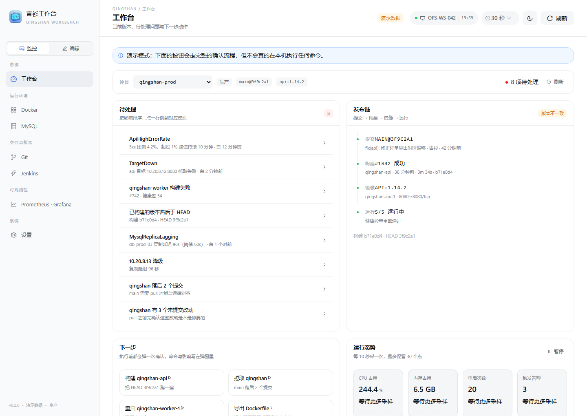
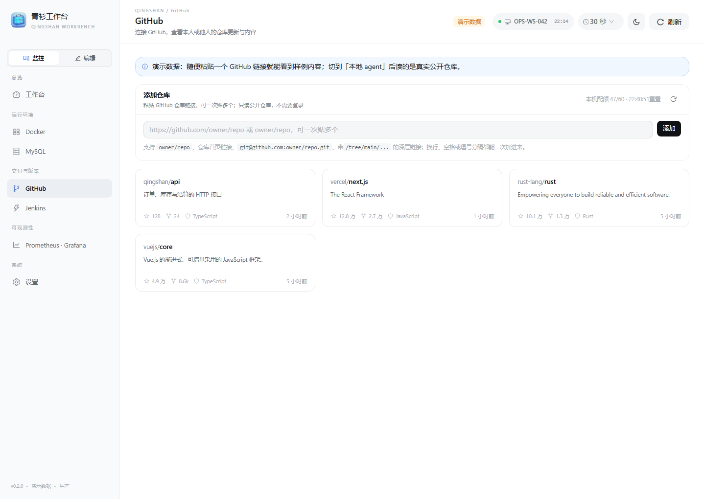

# 青衫工作台

以「青衫工具箱」的桌面框架为底座的 DevOps 工作台：同一套 Tauri 2 + Rust + React + Ant Design 外壳，换掉里面的内容——工具箱管本机，工作台管发布链。

- 一个窗口、两套模块：**监控**（工作台 / Docker / MySQL / GitHub / Jenkins / Prometheus · Grafana / 设置）与**编辑**（Dockerfile）。
- 工作台首页按「当前要干的事」组织：上下文条 → 待处理问题 → 发布链（提交 → 构建 → 镜像 → 运行）→ 下一步动作 → 运行态势。
- GitHub 模块直接读 GitHub 的 REST API：不用登录，贴仓库链接就能加，自己的库、同事的库、别人的开源项目一视同仁，看提交、分支、目录与 README，不 clone、不推送。
- 默认演示数据，也可以连本机 agent 读真实状态；快捷动作每次都要在确认弹窗里点一次「执行」。

框架与设计约定沿用青衫工具箱（同一套 token 与外壳），界面截图见 `docs/screenshots/`（工作台、Dockerfile 编辑器、设置、深色主题，以及打包后 exe 的实际窗口）。

## 仓库记录

- 仓库名：`-QingShanBox-`
- 当前提交为开发记录快照，**非正式发行版**；构建产物、依赖目录和本机交付目录不进入仓库。
- 正式发版、安装包和版本说明另行整理。






## 与青衫工具箱的关系

| | 青衫工具箱 | 青衫工作台（本仓库） |
| --- | --- | --- |
| 底座 | Tauri 2 + Rust + React + AntD 5 | 同左，直接复用其 `desktop/` 骨架 |
| 界面外壳 | 侧栏 + 顶栏 + 内容区 | 同左，多一个「监控 / 编辑」模块切换 |
| 内容 | 进程、服务、网络、日志、清理、启动项… | 发布链、容器、数据库、可观测性、Dockerfile |
| 数据来源 | 系统 API（Rust 侧采集） | 演示数据或本机 agent（HTTP，回环地址） |
| 执行 | 系统级操作 | 6 个白名单动作，逐次确认 |

两者互不依赖，可以同时安装。工具链是同一套（便携 Rust + GNU 目标），构建脚本也同构。

## 界面

- 侧栏顶部是「监控 / 编辑」切换，两个模块各记各的页面；切回来还是上次那一页。
- 顶栏：模式标签（演示数据 / 本地 agent / agent 未连接）、主机名与时间、刷新间隔、深浅色切换、手动刷新。
- 工作台首屏五段：上下文条、待处理问题、发布链、下一步动作、运行态势；点待处理项直接跳到对应模块。

## 目录

```
desktop/
  crates/            devops-core / devops-app / devops-platform / devops-plugins / devops-testkit
  src-tauri/         Tauri 外壳（窗口、托盘、单实例、命令白名单）
  ui/                前端（React + AntD 5 + Vite）
    src/
      App.tsx        路由、主题、刷新、页面装配
      components/    Sidebar、TopBar、ErrorBoundary
      devops/        工作台的领域代码
        lib/         类型、客户端、格式化、Dockerfile 渲染、监测、动作白名单、GitHub API、Markdown
        data/        演示数据
        components/  卡片、表格、弹窗等（内部用 AntD 实现）
        pages/       工作台、Docker、Dockerfile、MySQL、Terraform、Ansible、GitHub、Jenkins、可观测性、设置
        styles/      workbench.css
    server/          本机 agent（Node，零依赖，仅回环地址）
scripts/
  build-desktop.ps1  构建桌面端（debug / release / check）
legacy-web/          上一版纯网页实现，留作参考，不参与构建
```

## 开发

要求：Node 22+、便携 Rust 工具链（见下）。

```powershell
cd desktop/ui
npm install
npm run dev          # http://localhost:1420
npm test             # vitest
npm run build        # tsc --noEmit && vite build
```

`npm install` 若因内网镜像的 tarball 地址被拦（`EALLOWREMOTE`），可以临时复用工具箱已装好的依赖：
把 `..\DeepSeek-Devops\desktop\ui\node_modules` 整个复制到本目录，版本与 `package.json` 一致。

## 桌面构建

```powershell
# 首次：把仓库映射到 ASCII 盘，GNU dlltool 不认中文路径
subst S: "C:\Users\<user>\Documents\青衫工作台"

powershell -NoProfile -ExecutionPolicy Bypass -File S:\scripts\build-desktop.ps1 -Check     # 只编译检查
powershell -NoProfile -ExecutionPolicy Bypass -File S:\scripts\build-desktop.ps1           # debug（走 devUrl，需要 Vite）
powershell -NoProfile -ExecutionPolicy Bypass -File S:\scripts\build-desktop.ps1 -Release  # 独立可运行
```

- 脚本会依次找工具链：`$env:QINGSHAN_TOOLCHAIN_ROOT` → `<repo>\.toolchain` → `Documents\DeepSeek-Devops\.toolchain`（共用，不复制 4.6 GB）。
- release 产物落在 `QingshanWorkbench\`：`QingshanWorkbench.exe`、`WebView2Loader.dll`、`QingshanWorkbench-v0.2.0-win-x64.zip`、`SHA256SUMS.txt`。
- `custom-protocol` 特性会把 `desktop/ui/dist` 内嵌进二进制，所以出 release 前先 `npm run build`。
- 脚本含中文注释，**必须保存为 UTF-8 with BOM**，否则 Windows PowerShell 5.1 会按 GBK 解析报语法错误。
- `vite build` 若报 `esbuild-xxx: Access is denied`，把 `$env:TEMP` 指到仓库内（`$env:TEMP = "<repo>\.tmp"`）再跑。
- WebView2 的用户数据目录按顺序尝试：`QINGSHAN_WEBVIEW_DATA` → `%LOCALAPPDATA%\com.qingshan.workbench` → 可执行文件旁的 `webview\` → 系统临时目录。受限环境里 `%LOCALAPPDATA%` 不可写时会自动落到 exe 旁边，日志里不会中断启动。


## GitHub

Git 模块现在只读 GitHub：不 clone 到本地、不提交、不推送，全部走 `https://api.github.com`；**不需要登录、不填令牌**，贴仓库链接就能看。

- **添加仓库**：在「添加仓库」里贴 `owner/repo`、仓库首页链接、`git@github.com:owner/repo.git`，或者带 `/tree/main/…` 的深层链接；一次可以贴多条，换行、空格、逗号都能分隔。认不出的那几条会被列出来，不会静默丢掉。
- **展示**：已添加的库按一排三列排开，每张卡片显示 owner/name、简介、stars / forks / 语言 / 最近推送；点卡片进详情，详情页左上角「全部仓库」返回。
- **看别人**：任何公开仓库都能加，例如 `vercel/next.js`、`rust-lang/rust`，与自己的库一视同仁。
- **详情**：仓库元信息（stars / fork / issue / 语言 / 最近推送）、分支切换、提交列表、分支列表、目录下钻与文件内容、README（Markdown 在本地解析成结构渲染，不走 `innerHTML`）。
- **速率**：未登录时每个 IP 每小时 60 次，页面右上角显示「本机配额 xx/60 · 重置时间」；次数用完等重置，或过一会儿再刷。
- 错误都翻成中文：仓库不存在或不是公开仓库、接口次数用完、连不上 `api.github.com`，并给出下一步建议。
- 仓库清单存在本机 `localStorage`（`qingshan.workbench.github.repos`），不上传、不同步。

演示模式下内置 `qingshan/api`、`qingshan/web-console`、`vercel/next.js` 三个完整样例，另外 `rust-lang/rust`、`vuejs/core`、`facebook/react`、`microsoft/vscode`、`kubernetes/kubernetes`、`docker/compose`、`prometheus/prometheus`、`jenkinsci/jenkins`、`ansible/ansible`、`hashicorp/terraform` 这些常见库会给真实的元信息 + 标注过「演示」的提交与 README；其它仓库返回一条说明性的合成数据。切到「本地 agent」读的就是 GitHub 上的真实公开内容。

## 数据来源

| 模式 | 说明 |
| --- | --- |
| 演示数据 | 内置 fixtures，含一条「构建落后于 HEAD」的版本不一致、一个复制延迟的 MySQL 副本、一个 down 的抓取目标，用来演示告警与待办 |
| 本地 agent | 浏览器/桌面端用 `fetch` 打 `http://127.0.0.1:7331`，读本机 docker / git / Jenkins / Prometheus / Grafana |

启动 agent：

```powershell
cd desktop/ui
node server/agent.mjs          # 打印「执行令牌」与审计日志路径
```

环境变量：`QS_AGENT_PORT`（默认 7331）、`QS_AGENT_TOKEN`（不填则启动时随机生成并打印）、`QS_GIT_REPOS`（用 `;` 分隔的仓库路径，不填则扫当前目录与父目录）、`QS_PROMETHEUS_URL`、`QS_GRAFANA_URL`、`QS_GRAFANA_TOKEN`、`QS_JENKINS_URL`、`QS_JENKINS_USER`、`QS_JENKINS_TOKEN`。

把令牌填到「设置 → 执行令牌」，工作台才能下发命令；不填就只能看。

## 执行边界

工作台不是终端，只认 6 个白名单动作：

| 动作 | 命令 | 说明 |
| --- | --- | --- |
| `docker.restart` | `docker restart <container>` | 容器名先按正则校验 |
| `docker.start` / `docker.stop` | `docker start/stop <container>` | 同上 |
| `git.fetch` | `git -C <repo> fetch --prune` | 仓库必须是 agent 已发现的路径 |
| `git.pull` | `git -C <repo> pull --ff-only` | 同上，只做快进 |
| `jenkins.build` | `POST <jenkins>/job/<job>/build` | 需要 Jenkins 凭据，未配置则 501 |

- 每次执行都弹确认框，显示将要执行的命令与影响；演示模式下只回放示例输出。
- agent 侧再校验一次（令牌 + 白名单 + 路径/名字正则），并把每次调用追加到 `%TEMP%\qingshan-devops-actions.jsonl`。
- 不做的事：自由命令行、批量/定时执行、写文件、改配置、部署编排。

## 已知限制

- agent 尚未下沉到 Rust，桌面端要读真实数据得先手动起 `node server/agent.mjs`。
- GitHub 模块只读接口：不能 clone、不能看未提交的本地改动、不能提交或建 PR；单文件超过 1 MB 时接口不返回正文，只能去 GitHub 看。
- 工作台的发布链仍用本地仓库（agent 的 `git()`），与 GitHub 页的数据互相独立。
- Docker 只读最近一次采样的状态，没有实时流；容器日志只给命令，不内嵌终端。
- 前端未做代码分割，单个 JS 包约 1.1 MB（gzip 360 KB），首次加载偏慢。
- Jenkins 的「这次构建用的是哪个 commit」依赖 Jenkins 侧的 git 插件回写，缺失时显示「未记录」，版本一致性判定会退化成「无法核对」。

## 验证记录

- `npx tsc --noEmit` 通过；`npx vitest run` 13 个文件 113 个用例全绿（新增 GitHub 客户端 18 例、Markdown 解析 9 例）。
- `npx vite build` 3059 modules，CSS 48.53 kB（gzip 9.25）、JS 1,171.06 kB（gzip 370.74）。
- `cargo check` 通过（1m 51s）；release 构建产物见 `QingshanWorkbench\`。
- 界面逐页目检：工作台（浅色/深色）、Docker、Dockerfile、MySQL、GitHub（三列卡片 / 详情 / 文件 / README / 深色）、Jenkins、可观测性、设置、1440 与窄屏。
