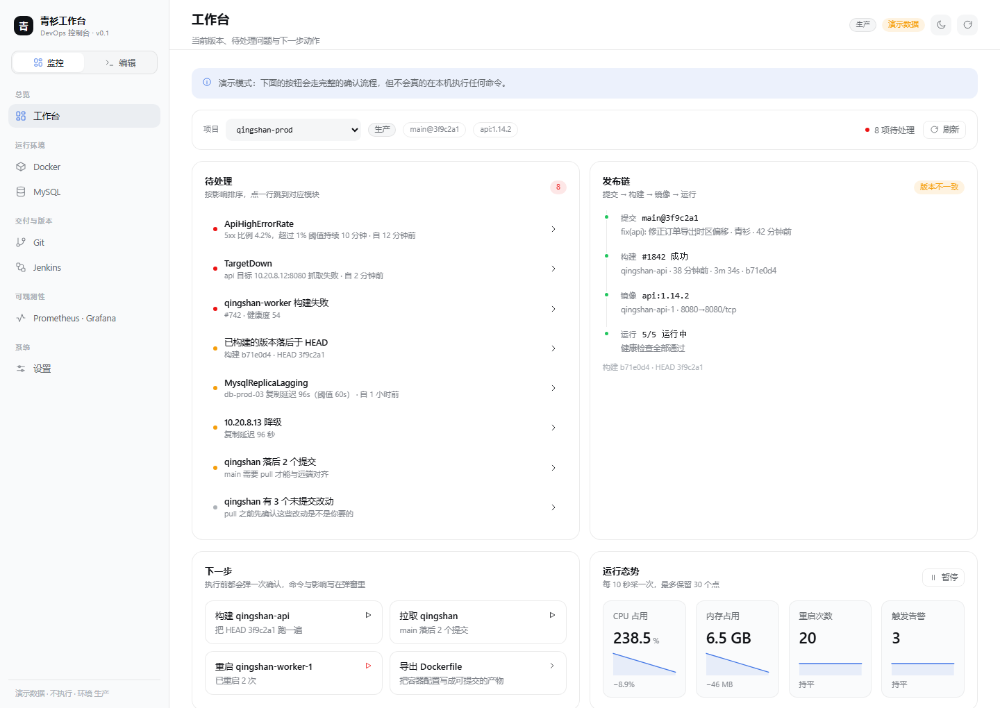

# 青衫工作台 · DevOps 控制台（web）

独立运行的 DevOps 工作台，侧栏顶部在**监控**与**编辑**两个模块之间切换，两个模块共用同一套数据源、设置与设计 token。

## 两个模块

| 模块 | 干什么 | 页面 |
| --- | --- | --- |
| **监控** | 只看不改：当前版本对不对、哪里需要处理、要动就点一次确认 | 工作台、Docker、MySQL、Git、Jenkins、Prometheus + Grafana、设置 |
| **编辑** | 只产出、不执行：把容器配置写成文件与命令 | Dockerfile（Dockerfile / 构建命令 / 运行命令 / compose 片段） |

- 模块切换会记住各自上次看的页面，首次进入分别是**工作台**和**Dockerfile**。
- 监控里的「导出 Dockerfile」等入口会自动跳到编辑模块。
- 可选模块 **Terraform / Ansible** 代码保留，默认在监控模块里隐藏，设置页可随时打开。

**监控**模块的首页是三段式：**先看当前版本对不对，再看待处理清单，最后一步执行**——当前项目 / 分支与提交 / 发布链（提交 → 构建 → 镜像 → 运行）/ 版本一致性 / 待处理问题 / 实时监测 / 最近操作。
监控里的白名单动作（重启容器、拉取代码、触发构建）可以一键下发，但**每次都要在确认弹窗里点一次执行**，命令与结果都写审计日志。

项目独立于 `DeepSeek-Devops`（青衫工具箱）仓库，位于 `C:\Users\青衫\Documents\青衫工作台`。
设计 token 取自工具箱的 `docs/design-system.md`，与桌面端同源；不引入 AntD，组件与样式都在本目录内。



界面截图在 `docs/screenshots/`：监控端（工作台、确认弹窗、执行结果、Docker、MySQL、Git、Jenkins、可观测性、设置）、编辑端（Dockerfile）、深色主题、窄屏。

## 快速开始

```powershell
npm install          # 若沙箱拒绝写默认 npm 缓存：$env:npm_config_cache = "$PWD/.npm-cache"
npm run dev          # http://127.0.0.1:1421
npm run build        # tsc --noEmit && vite build → dist/
npm run preview      # http://127.0.0.1:1422
npm test             # vitest run
npm run agent        # 本地采集/执行进程，127.0.0.1:7331
```

默认进入**演示模式**：页面用 `src/data/fixtures.ts` 里的确定性样例数据渲染，不访问任何外部服务；执行动作只走完整确认流程并返回模拟输出。
设置页可以切到**本地 agent 模式**，由本机 Node 进程采集真实状态，并按白名单真正执行命令。

## 工作台怎么用

首页按「当前要干的事」组织，不从菜单开始：

1. **上下文条**：项目下拉（按运行容器数排序）、环境标签、`分支@短 sha`、镜像 tag、待处理计数。
2. **待处理**：按影响排序，点任意一行跳到对应模块。来源包括版本落后、触发中的告警、失败流水线、不健康/退出容器、MySQL 非运行、落后远端的提交、未提交改动、Docker 无数据。
3. **发布链**：提交 → 构建 → 镜像 → 运行四段，右上角给出「版本一致 / 版本不一致 / 无法核对」。不一致时列出 `构建 b71e0d4 · HEAD 3f9c2a1`。
4. **下一步**：把当前上下文能做的动作排在前面（触发构建、拉取、重启最差的容器、导出 Dockerfile）。
5. **运行态势**：10 秒一采样，看趋势；**最近操作**：本机执行过的命令与结果。

## 执行边界（重要）

- 动作**只能从固定白名单里选**，不接受自由命令行：`docker.restart / docker.start / docker.stop`、`git.fetch`、`git.pull`、`jenkins.build`。
- 每次执行前弹确认：说明影响、显示将要执行的命令；执行后显示成功/失败、耗时与输出。演示模式下带「演示 · 未真的执行」标记。
- **令牌**：agent 启动时生成并打印「执行令牌」，填在设置页（只存在本机浏览器 `localStorage`）。没有令牌时前端直接拒绝下发。
- **白名单校验在 agent 侧**：容器名走正则；`git` 的 `-C` 路径必须是 agent 已发现的本机仓库；Jenkins 任务名走正则。请求头 `X-Qingshan-Token` 用 `crypto.timingSafeEqual` 比较；非回环 Origin 直接 403。
- **审计**：每次执行（成功或失败）追加一行 JSON 到 `%TEMP%\qingshan-devops-actions.jsonl`，含时间、动作、目标、命令、结果、耗时、来源、pid。
- 仍然不做的写操作：`terraform apply`、`ansible-playbook` 实跑、容器内 shell、镜像构建与推送、MySQL 变更。这些要等审批与凭据托管一起做。

## Dockerfile 编辑器

`Dockerfile` 页把「容器怎么跑」变成可编辑的表单，右侧实时渲染四种产物：

| Tab | 产物 |
| --- | --- |
| Dockerfile | 可直接存盘的 `Dockerfile` |
| 构建命令 | `docker build -t <name>:<tag> .` |
| 运行命令 | 带端口、数据卷、环境变量、`--restart unless-stopped` 的 `docker run` |
| compose 片段 | 可粘贴进 `docker-compose.yml` 的 service |

- **只生成产物，不执行**：编辑器不会在你机器上跑 `docker build` / `docker run`，需要自己复制或导出后执行。
- **草稿存本地**：`localStorage` 的 `qingshan.devops.dockerfile.drafts`，换机器需要重新导出。
- **从运行中的容器导入**：agent 模式下可从容器反推镜像、启动命令、端口与 compose 项目标签；反推不出来的字段留空，不猜。
- **导出**：`导出` 按钮下载对应文件（`Dockerfile` / `<name>-build.txt` / `<name>-compose.yml` 等）。
- 校验提示（缺基础镜像、没有 CMD/ENTRYPOINT、没有端口等）显示在预览下方，不阻塞导出。

## 实时监测

工作台「运行态势」每 10 秒采样一次（最多保留 30 个点），四个指标都带曲线与相对首个采样点的变化量：

- CPU 合计、内存占用、容器重启次数、触发中的告警数；变化量按指标带单位（`%`、`MB`、`次`、`条`）。
- 可随时「暂停」采点；采点失败时保留已有曲线，只在上方提示原因。
- 演示模式的数据会小幅抖动（`src/lib/client.ts` 的 `drift*` 函数），否则曲线是一条直线，看不出趋势。

## 模块开关

Terraform 与 Ansible 默认隐藏（`Settings.modules`，存在 `qingshan.devops.settings` 里）。
设置页「模块」卡片可切换显示/隐藏，保存后侧栏、工作台数据源、路由都同步生效：直接访问被隐藏页面的 hash 会被重定向回工作台。

## 本地 agent

```powershell
npm run agent
```

- 只绑定 `127.0.0.1:7331`；CORS 仅放行 `localhost` / `127.0.0.1` 来源。
- 采集：`/api/health`、`/api/sources`、`/api/docker`（真实容器/镜像/compose 项目 + `docker stats` 采样）、`/api/git`（真实仓库状态、最近 20 次提交、分支跟踪）。
- 执行：`POST /api/actions`（见上文「执行边界」）。
- 优雅降级：`/api/mysql`、`/api/terraform`、`/api/ansible`、`/api/jenkins` 返回空结构 + 中文说明；`/api/observability` 在配置 `QS_PROMETHEUS_URL` 后读取 targets / alerts。
- 环境变量：`QS_AGENT_PORT`、`QS_AGENT_TOKEN`、`QS_GIT_REPOS`（用系统路径分隔符分隔）、`QS_JENKINS_URL`、`QS_JENKINS_USER`、`QS_JENKINS_TOKEN`、`QS_PROMETHEUS_URL`、`QS_GRAFANA_URL`、`QS_GRAFANA_TOKEN`。
- Docker daemon 未启动时不会报 500，而是返回空快照并让「数据源」卡片显示为不可用。

## 目录结构

```
├── index.html                # 首帧定主题，避免暗色闪烁
├── server/agent.mjs          # 本地采集 + 白名单执行 + 审计
├── src/
│   ├── App.tsx               # hash 路由、主题、设置、模块开关、全页刷新
│   ├── components/           # Icons / ui（Card、Table、Drawer…）/ Toast / Sidebar / TopBar / ConfirmDialog
│   ├── data/fixtures.ts      # 确定性演示数据
│   ├── lib/                  # types、client、store、useResource、format
│   │                         # workbench.ts（发布链与待处理推导）、actions.ts（白名单与命令预览）
│   │                         # activity.ts（最近操作）、dockerfile.ts（草稿与四种产物）、monitor.ts（采样与趋势）
│   ├── pages/                # 工作台 + 常用模块 + Dockerfile + 设置（Terraform/Ansible 保留）
│   └── styles/               # tokens.css（语义变量）+ app.css（布局与组件）
└── vite.config.ts            # base="./"，/api 代理到 127.0.0.1:7331
```

数据流是单向的：`client`（demo / agent）→ `useResource`（loading / error / reload）→ 页面渲染。
页面不直接 `fetch`，也不把业务数据写回存储；设置存 `qingshan.devops.settings`，草稿存 `qingshan.devops.dockerfile.drafts`，操作记录存 `qingshan.devops.activity`。

## 与青衫工具箱的关系

现在是**两个独立产品**：工具箱是桌面端工具箱，本项目是浏览器里的工作台；共享设计 token 与领域约定，不共享进程。

如果之后要接进桌面端（先做只读接入，执行通道仍留在 web/agent）：

1. 把 `src/lib`（types / client / format）与 `src/components` 提升为 `desktop/ui` 可复用模块，或把 `src/` 作为 `desktop/ui/src/devops/` 引入。
2. `desktop/ui/src/types.ts` 的 `PageKey` 增加 `devops` 与各子页；`Sidebar.tsx` 的 `NAV_ITEMS` 增加分组；`App.tsx` 的 `PAGE_META` 与 `switch (page)` 增加分支。
3. `desktop/src-tauri/src/lib.rs` 增加 devops 只读命令（docker/git 采集、文件探测），采集逻辑下沉到 `devops-platform`。
4. 执行动作走 Tauri 侧审批弹窗 + 同样的审计表；不要在 WebView 里直接调 shell。

## 降级与提示

agent 模式读不到某个数据源时，接口会带一个 `note` 字段，页面顶部以黄色提示条展示，不会把「空数据」渲染成「一切正常」。
例如本机 Docker daemon 未启动时，Docker 页显示：`Docker daemon 未就绪：连不上本机的 Docker 引擎（npipe），先启动 Docker Desktop，再点右上角刷新。`
MySQL / Terraform / Ansible / Jenkins 在 agent 模式下同样返回带 `note` 的空结构，页面只展示说明，不展示编造的数字。

## 验证记录

- `npm run build`（`tsc --noEmit && vite build`）通过：54 modules，JS 272.25 kB（gzip 85.51 kB）、CSS 26.92 kB（gzip 5.65 kB）。
- `npm test` 通过：9 个测试文件、73 个用例（格式化、设置存储与 modules 迁移、客户端、agent 契约、演示数据自洽、Dockerfile 渲染、监测采样与趋势、工作台推导、白名单动作）。
- 十三个页面/状态在 1440×1020 浅色与深色、880×900 窄屏下逐页截图目检（对着 `npm run preview` 的构建产物，不是 dev server）。
- CDP 逐项点击确认：监控 ↔ 编辑切换（保留各自上次页面）、工作台「导出 Dockerfile」直达编辑模块、深链 `#/dockerfile` 自动把侧栏切到编辑；工作台快捷动作 → 确认弹窗 → 演示执行结果 → 最近操作落库、待处理行跳转、模块显示/隐藏、从容器导入、Dockerfile 四 Tab、窄屏折叠。
- agent 端到端：`/api/health`、`/api/git` 返回真实仓库与提交；`/api/docker` 在 daemon 未启动时按上面的提示条降级；`POST /api/actions` 用正确令牌成功执行 `git fetch --prune` 并写入审计，错误令牌 401，未发现仓库 403。

> 验证提示：本机沙箱下 `vite dev` 的文件监听偶尔不刷新（改完代码页面白屏或样式不生效），此时**重启 dev 进程**即可；正式验证请用 `npm run preview` 看构建产物。

## 已知限制

- MySQL / Terraform / Ansible / Jenkins 的采集未实现，agent 模式下这几页是空表 + 说明；演示模式数据仅供界面评审。
- Docker 的 CPU / 内存来自 `docker stats --no-stream` 单次采样；「运行态势」只是页面开着时按 10 秒轮询，关掉页面就停。
- Dockerfile 编辑器不执行构建，也不回连 Docker daemon 校验镜像是否存在；产物是否可构建需要自己跑一次。
- 版本一致性依赖 Jenkins 构建记录里的 commit（需要 Jenkins 的 git 插件回写）；没回写时显示「无法核对」。
- 执行令牌存在浏览器 `localStorage`，与 agent 之间是回环 HTTP，没有 TLS；适合单机使用，不适合多用户共享一台 agent。
- 主题、视角与信息密度以浅色为主，深色主题通过 `data-theme="dark"` 切换，已覆盖全部页面。
